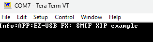

# EZ-USB&trade; FX20: SMIF Execute-in-Place application

This code example demonstrates EZ-USB&trade; FX20 device's capability to execute code directly from an external 
SPI flash using the Serial Memory Interface (SMIF) peripheral's Execute-in-Place (XIP) mode. <br>
In this example, the PMODE/BOOT switch is configured as a GPIO interrupt to toggle the User LED whenever the switch is pressed.
The interrupt handler signals the main application to call `Cy_HandleBootSwitchEvent()`, which toggles the User LED.
The `Cy_HandleBootSwitchEvent()` function is executed from the external SPI flash in XIP mode.

> **Note:** This code example is also applicable to EZ-USB&trade; FX10, EZ-USB&trade; FX5N, and EZ-USB&trade; FX5 devices.

[View this README on GitHub.](https://github.com/Infineon/mtb-example-fx20-smif-xip)

[Provide feedback on this code example.](https://yourvoice.infineon.com/jfe/form/SV_1NTns53sK2yiljn?Q_EED=eyJVbmlxdWUgRG9jIElkIjoiQ0UyNDIwOTgiLCJTcGVjIE51bWJlciI6IjAwMi00MjA5OCIsIkRvYyBUaXRsZSI6IkVaLVVTQiZ0cmFkZTsgRlgyMDogU01JRiBFeGVjdXRlLWluLVBsYWNlIGFwcGxpY2F0aW9uIiwicmlkIjoia2FydGhpay5zaXZhcmFtYWtyaXNobmFuQGluZmluZW9uLmNvbSIsIkRvYyB2ZXJzaW9uIjoiMS4wLjEiLCJEb2MgTGFuZ3VhZ2UiOiJFbmdsaXNoIiwiRG9jIERpdmlzaW9uIjoiTUNEIiwiRG9jIEJVIjoiV0lSRUQiLCJEb2MgRmFtaWx5IjoiU1NfVVNCIn0=)


## Requirements

- [ModusToolbox&trade;](https://www.infineon.com/modustoolbox) v3.6 or later (tested with v3.6)
- Board support package (BSP) minimum required version: 4.3.3
- Programming language: C


## Supported toolchains (make variable 'TOOLCHAIN')

- GNU Arm&reg; Embedded Compiler v11.3.1 (`GCC_ARM`) – Default value of `TOOLCHAIN`
- Arm&reg; Compiler v6.22 (`ARM`)


## Supported kits (make variable 'TARGET')

- [EZ-USB&trade; FX20 DVK](https://www.infineon.com/fx20) (`KIT_FX20_FMC_001`) – Default value of `TARGET`


## Hardware setup

This example uses the board's default configuration. See the kit user guide to ensure that the board is configured correctly.


## Software setup

See the [ModusToolbox&trade; tools package installation guide](https://www.infineon.com/ModusToolboxInstallguide) for information about installing and configuring the tools package.

Install a terminal emulator if you do not have one. Instructions in this document use [Tera Term](https://teratermproject.github.io/index-en.html).

Install the [EZ-USB&trade; FX Control Center](https://softwaretools.infineon.com/tools/com.ifx.tb.tool.ezusbfxcontrolcenter) application for assistance with device programming and testing.


## Using the code example

### Create the project

The ModusToolbox&trade; tools package provides the Project Creator as both a GUI tool and a command line tool.

<details><summary><b>Use Project Creator GUI</b></summary>

1. Open the Project Creator GUI tool

   There are several ways to do this, including launching it from the dashboard or from inside the Eclipse IDE. For more details, see the [Project Creator user guide](https://www.infineon.com/ModusToolboxProjectCreator) (locally available at *{ModusToolbox&trade; install directory}/tools_{version}/project-creator/docs/project-creator.pdf*)

2. On the **Choose Board Support Package (BSP)** page, select a kit supported by this code example. See [Supported kits](#supported-kits-make-variable-target)

   > **Note:** To use this code example for a kit not listed here, you may need to update the source files. If the kit does not have the required resources, the application may not work

3. On the **Select Application** page:

   a. Select the **Applications(s) Root Path** and the **Target IDE**

      > **Note:** Depending on how you open the Project Creator tool, these fields may be pre-selected for you

   b. Select this code example from the list by enabling its check box

      > **Note:** You can narrow the list of displayed examples by typing in the filter box

   c. (Optional) Change the suggested **New Application Name** and **New BSP Name**

   d. Click **Create** to complete the application creation process

</details>


<details><summary><b>Use Project Creator CLI</b></summary>

The 'project-creator-cli' tool can be used to create applications from a CLI terminal or from within batch files or shell scripts. This tool is available in the *{ModusToolbox&trade; install directory}/tools_{version}/project-creator/* directory.

Use a CLI terminal to invoke the 'project-creator-cli' tool. On Windows, use the command-line 'modus-shell' program provided in the ModusToolbox&trade; installation instead of a standard Windows command-line application. This shell provides access to all ModusToolbox&trade; tools. You can access it by typing "modus-shell" in the search box in the Windows menu. In Linux and macOS, you can use any terminal application.

The following example clones the "[mtb-example-fx20-smif-xip](https://github.com/Infineon/mtb-example-fx20-smif-xip)" application with the desired name "FX20_SMIF_XIP" configured for the *KIT_FX20_FMC_001* BSP into the specified working directory, *C:/mtb_projects*:

   ```
   project-creator-cli --board-id KIT_FX20_FMC_001 --app-id mtb-example-fx20-smif-xip --user-app-name FX20_SMIF_XIP --target-dir "C:/mtb_projects"
   ```

The 'project-creator-cli' tool has the following arguments:

Argument | Description | Required/optional
---------|-------------|-----------
`--board-id` | Defined in the <id> field of the [BSP](https://github.com/Infineon?q=bsp-manifest&type=&language=&sort=) manifest | Required
`--app-id`   | Defined in the <id> field of the [CE](https://github.com/Infineon?q=ce-manifest&type=&language=&sort=) manifest | Required
`--target-dir`| Specify the directory in which the application is to be created if you prefer not to use the default current working directory | Optional
`--user-app-name`| Specify the name of the application if you prefer to have a name other than the example's default name | Optional

<br>

> **Note:** The project-creator-cli tool uses the `git clone` and `make getlibs` commands to fetch the repository and import the required libraries. For details, see the "Project creator tools" section of the [ModusToolbox&trade; tools package user guide](https://www.infineon.com/ModusToolboxUserGuide) (locally available at {ModusToolbox&trade; install directory}/docs_{version}/mtb_user_guide.pdf).

</details>


### Open the project

After the project has been created, you can open it in your preferred development environment.


<details><summary><b>Eclipse IDE</b></summary>

If you opened the Project Creator tool from the included Eclipse IDE, the project will open in Eclipse automatically.

For more details, see the [Eclipse IDE for ModusToolbox&trade; user guide](https://www.infineon.com/MTBEclipseIDEUserGuide) (locally available at *{ModusToolbox&trade; install directory}/docs_{version}/mt_ide_user_guide.pdf*).

</details>


<details><summary><b>Visual Studio (VS) Code</b></summary>

Launch VS Code manually, and then open the generated *{project-name}.code-workspace* file located in the project directory.

For more details, see the [Visual Studio Code for ModusToolbox&trade; user guide](https://www.infineon.com/MTBVSCodeUserGuide) (locally available at *{ModusToolbox&trade; install directory}/docs_{version}/mt_vscode_user_guide.pdf*).

</details>


<details><summary><b>Command line</b></summary>

If you prefer to use the CLI, open the appropriate terminal, and navigate to the project directory. On Windows, use the command-line 'modus-shell' program; on Linux and macOS, you can use any terminal application. From there, you can run various `make` commands.

For more details, see the [ModusToolbox&trade; tools package user guide](https://www.infineon.com/ModusToolboxUserGuide) (locally available at *{ModusToolbox&trade; install directory}/docs_{version}/mtb_user_guide.pdf*).

</details>


### Products

By default, the code example build is targeted for the CYUSB4024-BZXI MPN, which has 512 KB of flash memory and 1024 KB of buffer RAM. Use the **BSP Assistant** tool to modify the application to target different EZ-USB&trade; FX20, EZ-USB&trade; FX10, EZ-USB&trade; FX5N, or EZ-USB&trade; FX5 family products as shown in **Table 1**.

**Table 1. Products supported by this code example**

Part Number       | Family | Flash size (KB) | Buffer RAM size (KB) | SMIF support
:---------------- | :----- | :-------------- | :------------------- | :----------------
CYUSB4024-BZXI    | FX20   | 512             | 1024                 | Yes
CYUSB4022-FCAXI   | FX20   | 512             | 1024                 | No
CYUSB4021-FCAXI   | FX20   | 512             | 1024                 | Yes
CYUSB4014-FCAXI   | FX10   | 512             | 1024                 | Yes
CYUSB4013-FCAXI   | FX10   | 512             | 1024                 | Yes
CYUSB4012-FCAXI   | FX10   | 256             | 512                  | No
CYUSB4011-FCAXI   | FX10   | 512             | 1024                 | Yes
CYUSB3284-FCAXI   | FX5N   | 512             | 1024                 | Yes
CYUSB3282-FCAXI   | FX5N   | 256             | 512                  | No
CYUSB3084-FCAXI   | FX5    | 512             | 1024                 | Yes
CYUSB3083-FCAXI   | FX5    | 512             | 1024                 | Yes
CYUSB3082-FCAXI   | FX5    | 256             | 512                  | No
CYUSB3081-FCAXI   | FX5    | 512             | 512                  | Yes
<br>

#### Setup for a different MPN

Perform the following steps to modify the code example to work on different products, as listed in **Table 1**:

1. Launch the BSP Assistant tool:

   a. **Eclipse IDE:** Launch the BSP Assistant tool by navigating to **Quick Panel** > **Tools**

   b. **Visual Studio Code:** Select the ModusToolbox&trade; extension from the left menu bar and launch the BSP Assistant tool, which is available in the **Application** menu of the **MODUSTOOLBOX TOOLS** section

2. In **BSP Assistant**, select **Devices** from the tree view on the left

3. Choose the desired part from the dropdown menu on the right

4. Click **Save** to close the BSP Assistant tool

5. Build the application and proceed with programming


## Operation

1. Connect the board (J2) to your PC using the provided USB cable

2. Connect the USB FS port (J3) on the board to the PC for debug logs

3. Open a terminal program and select the serial COM port. Set the serial port parameters to 8N1 and 921600 baud

4. Perform the following steps to program the board using the EZ-USB&trade; FX Control Center (Alpha) application

   1. To enter Bootloader mode:

         a. Press and hold the PMODE (SW2) switch

         b. Press and release the RESET (SW3) switch

         c. Release the PMODE switch

   2. Open the EZ-USB&trade; FX Control Center application. Observe the EZ-USB&trade; FX20 device displayed as **EZ-USB&trade; FX Bootloader**

   3. Select the **EZ-USB&trade; FX Bootloader** device in EZ-USB&trade; FX Control Center

   4. Click Program > External Flash (without Metadata) and choose mtb-example-fx20-smif-xip-qspi.bin file located in the *\<CE Title>/build/APP_KIT_FX20_FMC_001/Release* folder within the CE directory and program. Confirm if the programming is successful in the log window of the EZ-USB&trade; FX Control Center application. This loads the code placed in the XIP region to the external SPI flash

   5. Click **Program** > **Internal Flash**

   6. Navigate to the *\<CE Title>/build/APP_KIT_FX20_FMC_001/Release* folder within the CE directory and locate the *.hex* file and program. Confirm if the programming is successful in the log window of the EZ-USB&trade; FX Control Center application

    7. After programming, the application starts automatically. Confirm that the following title is displayed on the serial terminal
     

    6. Press the PMODE/BOOT (SW2) switch on the board. Observe that the User LED toggles its state each time the switch is pressed


## Debugging


### Using the Arm&reg; debug port

If you have access to a MiniProg or KitProg3 device, you can debug the example to step through the code.
<details><summary><b>In Eclipse IDE</b></summary>

Use the **\<Application Name> Debug (KitProg3_MiniProg4)** configuration in the **Quick Panel**. For details, see the "Program and debug" section in the [Eclipse IDE for ModusToolbox&trade; user guide](https://www.infineon.com/MTBEclipseIDEUserGuide).

</details>


<details><summary><b>In other IDEs</b></summary>

Follow the instructions in your preferred IDE.

</details>


### Log messages

The code example and the EZ-USB&trade; FX20 stack output debug log messages indicate any unexpected conditions and highlight the performed operations.

By default, the USB FS port is enabled for debug logs. To enable debug logs on UART, set the `USBFS_LOGS_ENABLE` compiler flag to '0u' in the *Makefile* file. SCB1 of the EZ-USB&trade; FX20 device is used as UART with a baud rate of 921600 to send out log messages through the P8.1 pin.

The verbosity of the debug log output can be modified by setting the `DEBUG_LEVEL` macro in the *main.c* file with the values shown in **Table 2**.

**Table 2. Debug values**

Macro value | Description
:--------   | :------------
1u          | Enable only error messages
2u          | Enable error and warning messages
3u          | Enable error, warning, and info messages
4u          | Enable all message types


## Compile-time configurations

This application's functionality can be customized by setting variables in *Makefile* or by configuring them through `make` CLI arguments.

- Run the `make build` command or build the project in your IDE to compile the application and generate a USB bootloader-compatible binary. This binary can be programmed onto the EZ-USB&trade; FX20 device using the EZ-USB&trade; Control Center application

- Run the `make build BLENABLE=no` command or set the variable in *Makefile* to compile the application and generate the standalone binary. This binary can be programmed onto the EZ-USB&trade; FX20 device through the SWD interface using the OpenOCD tool. For more details, see [EZ-USB&trade; FX20 SDK user guide](https://www.infineon.com/fx20)

- Run the `make build CORE=CM0P` command or set the variable in *Makefile* to compile and generate the binary for the Cortex&reg; M0+ core. By default, `CORE` is set as `CM4` and the binary is compiled and generated for the Cortex&reg; M4 core

- Choose between the **Arm&reg; Compiler** or the **GNU Arm&reg; Embedded Compiler** build toolchains by setting the `TOOLCHAIN` variable in *Makefile* to `ARM` or `GCC_ARM` respectively. If you set it to `ARM`, ensure to set `CY_COMPILER_ARM_DIR` as a make variable or environment variable, pointing to the path of the compiler's root directory

Additional settings can be configured through macros specified by the `DEFINES` variable in *Makefile*:

**Table 3. Macro description**

Macro name | Description   | Allowed values
:--------  | :------------ | :-------------
`USBFS_LOGS_ENABLE` | Enable debug logs through the USBFS debug port | '1u' to select debug logs over the USBFS port <br> '0u' to select debug logs over the UART (SCB1)

<br>

## Related resources

Resources  | Links
-----------|----------------------------------
Application notes  | [AN237841](https://www.infineon.com/dgdl/Infineon-Getting_started_with_EZ_USB_FX20_FX10_FX5N_FX5-ApplicationNotes-v01_00-EN.pdf?fileId=8ac78c8c956a0a470195a515c54916e1) – Getting started with EZ-USB&trade; FX20/FX10/FX5N/FX5
Code examples  | [Using ModusToolbox&trade;](https://github.com/Infineon/Code-Examples-for-ModusToolbox-Software) on GitHub
Device documentation | [EZ-USB&trade; FX20 datasheets](https://www.infineon.com/fx20)
Development kits | Select your kits from the [Evaluation board finder](https://www.infineon.com/cms/en/design-support/finder-selection-tools/product-finder/evaluation-board)
Libraries on GitHub  | [mtb-pdl-cat1](https://github.com/Infineon/mtb-pdl-cat1) – Peripheral Driver Library (PDL)
Middleware on GitHub  | [usbfxstack](https://github.com/Infineon/usbfxstack) – USBFX Stack middleware library and documents
Tools  | [ModusToolbox&trade;](https://www.infineon.com/modustoolbox) – ModusToolbox&trade; software is a collection of easy-to-use libraries and tools enabling rapid development with Infineon MCUs for applications ranging from wireless and cloud-connected systems, edge AI/ML, embedded sense and control, to wired USB connectivity using PSOC&trade; Industrial/IoT MCUs, AIROC&trade; Wi-Fi and Bluetooth&reg; connectivity devices, XMC&trade; Industrial MCUs, and EZ-USB&trade;/EZ-PD&trade; wired connectivity controllers. ModusToolbox&trade; incorporates a comprehensive set of BSPs, HAL, libraries, configuration tools, and provides support for industry-standard IDEs to fast-track your embedded application development

<br>


## Other resources

Infineon provides a wealth of data at [www.infineon.com](https://www.infineon.com) to help you select the right device, and quickly and effectively integrate it into your design.


## Document history

Document title: *CE242098* – *EZ-USB&trade; FX20: SMIF Execute-in-Place application*

 Version | Description of change
 ------- | ---------------------
 1.0.0   | New code example
 1.0.1   | Added IAR compiler support

<br>


All referenced product or service names and trademarks are the property of their respective owners.

The Bluetooth&reg; word mark and logos are registered trademarks owned by Bluetooth SIG, Inc., and any use of such marks by Infineon is under license.

PSOC&trade;, formerly known as PSoC&trade;, is a trademark of Infineon Technologies. Any references to PSoC&trade; in this document or others shall be deemed to refer to PSOC&trade;.

---------------------------------------------------------

© Cypress Semiconductor Corporation, 2025. This document is the property of Cypress Semiconductor Corporation, an Infineon Technologies company, and its affiliates ("Cypress").  This document, including any software or firmware included or referenced in this document ("Software"), is owned by Cypress under the intellectual property laws and treaties of the United States and other countries worldwide.  Cypress reserves all rights under such laws and treaties and does not, except as specifically stated in this paragraph, grant any license under its patents, copyrights, trademarks, or other intellectual property rights.  If the Software is not accompanied by a license agreement and you do not otherwise have a written agreement with Cypress governing the use of the Software, then Cypress hereby grants you a personal, non-exclusive, nontransferable license (without the right to sublicense) (1) under its copyright rights in the Software (a) for Software provided in source code form, to modify and reproduce the Software solely for use with Cypress hardware products, only internally within your organization, and (b) to distribute the Software in binary code form externally to end users (either directly or indirectly through resellers and distributors), solely for use on Cypress hardware product units, and (2) under those claims of Cypress's patents that are infringed by the Software (as provided by Cypress, unmodified) to make, use, distribute, and import the Software solely for use with Cypress hardware products.  Any other use, reproduction, modification, translation, or compilation of the Software is prohibited.
<br>
TO THE EXTENT PERMITTED BY APPLICABLE LAW, CYPRESS MAKES NO WARRANTY OF ANY KIND, EXPRESS OR IMPLIED, WITH REGARD TO THIS DOCUMENT OR ANY SOFTWARE OR ACCOMPANYING HARDWARE, INCLUDING, BUT NOT LIMITED TO, THE IMPLIED WARRANTIES OF MERCHANTABILITY AND FITNESS FOR A PARTICULAR PURPOSE.  No computing device can be absolutely secure.  Therefore, despite security measures implemented in Cypress hardware or software products, Cypress shall have no liability arising out of any security breach, such as unauthorized access to or use of a Cypress product. CYPRESS DOES NOT REPRESENT, WARRANT, OR GUARANTEE THAT CYPRESS PRODUCTS, OR SYSTEMS CREATED USING CYPRESS PRODUCTS, WILL BE FREE FROM CORRUPTION, ATTACK, VIRUSES, INTERFERENCE, HACKING, DATA LOSS OR THEFT, OR OTHER SECURITY INTRUSION (collectively, "Security Breach").  Cypress disclaims any liability relating to any Security Breach, and you shall and hereby do release Cypress from any claim, damage, or other liability arising from any Security Breach.  In addition, the products described in these materials may contain design defects or errors known as errata which may cause the product to deviate from published specifications. To the extent permitted by applicable law, Cypress reserves the right to make changes to this document without further notice. Cypress does not assume any liability arising out of the application or use of any product or circuit described in this document. Any information provided in this document, including any sample design information or programming code, is provided only for reference purposes.  It is the responsibility of the user of this document to properly design, program, and test the functionality and safety of any application made of this information and any resulting product.  "High-Risk Device" means any device or system whose failure could cause personal injury, death, or property damage.  Examples of High-Risk Devices are weapons, nuclear installations, surgical implants, and other medical devices.  "Critical Component" means any component of a High-Risk Device whose failure to perform can be reasonably expected to cause, directly or indirectly, the failure of the High-Risk Device, or to affect its safety or effectiveness.  Cypress is not liable, in whole or in part, and you shall and hereby do release Cypress from any claim, damage, or other liability arising from any use of a Cypress product as a Critical Component in a High-Risk Device. You shall indemnify and hold Cypress, including its affiliates, and its directors, officers, employees, agents, distributors, and assigns harmless from and against all claims, costs, damages, and expenses, arising out of any claim, including claims for product liability, personal injury or death, or property damage arising from any use of a Cypress product as a Critical Component in a High-Risk Device. Cypress products are not intended or authorized for use as a Critical Component in any High-Risk Device except to the limited extent that (i) Cypress's published data sheet for the product explicitly states Cypress has qualified the product for use in a specific High-Risk Device, or (ii) Cypress has given you advance written authorization to use the product as a Critical Component in the specific High-Risk Device and you have signed a separate indemnification agreement.
<br>
Cypress, the Cypress logo, and combinations thereof, ModusToolbox, PSoC, CAPSENSE, EZ-USB, F-RAM, and TRAVEO are trademarks or registered trademarks of Cypress or a subsidiary of Cypress in the United States or in other countries. For a more complete list of Cypress trademarks, visit www.infineon.com. Other names and brands may be claimed as property of their respective owners.
